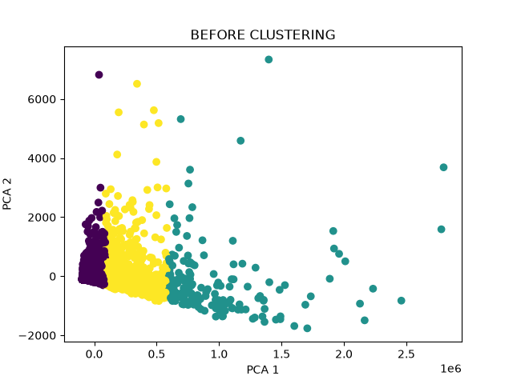
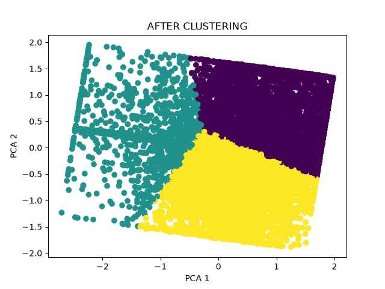

# IMDb Movies — Data Mining & Machine Learning

A university data analysis project exploring movie ratings, clustering patterns, and associations in the IMDb Movies Dataset. The project contains two complementary analyses: supervised classification and unsupervised data mining.

## Project overview

### Part 1 — Movie classification
- Classify films into **Bad** (rating < 5.5), **Average** (5.5–7.0), and **Good** (rating > 7.0).
- Compare **Logistic Regression** and **Random Forest** before and after preprocessing.
- Evaluate predictions using accuracy, classification reports, and confusion matrices.

### Part 2 — K-Means clustering and Apriori
- Cluster films using **Metascore**, **Votes**, and **Review Count**.
- Compare K-Means with minimal preprocessing against a version using quantile clipping, log transformations, and **RobustScaler**.
- Visualize clusters in two dimensions using **PCA**.
- Evaluate clustering using **Silhouette Score** and **Davies–Bouldin Index**.
- Discover association rules using **Apriori**, with **support**, **confidence**, and **lift**.

## Tech stack
Python, pandas, NumPy, scikit-learn, Matplotlib, and mlxtend.

## Project structure

```text
imdb-movies-data-mining/
├── classification.py
├── clustering_apriori.py
├── README.md
├── requirements.txt
├── .gitignore
├── data/
│   └── imdb-movies-dataset.csv
├── results/
│   ├── kmeans_before.png
│   ├── kmeans_after.png
│   ├── all_rules_clean.csv
│   └── interesting_rules.csv
└── reports/                 # optional
    ├── classification_report.docx
    └── clustering_report.pdf
```

> The script filenames above are suggested names. If your actual filenames differ, update the commands below. The classification script may have additional outputs that you can document separately.

## Dataset

The dataset was sourced from Kaggle: **IMDb Movies Dataset**.

**Source:** [Add the exact Kaggle dataset URL here]

Before redistributing the CSV in this repository, check the dataset's license/terms. If redistribution is not permitted, exclude `data/imdb-movies-dataset.csv` from Git and instruct users to download it from the source.

## Setup

Use Python 3.10 or newer (subject to compatibility with installed packages).

```bash
python -m venv .venv
```

Activate your virtual environment:

- Windows PowerShell: `.venv\Scripts\Activate.ps1`
- macOS/Linux: `source .venv/bin/activate`

Install dependencies:

```bash
python -m pip install -r requirements.txt
```

Place `imdb-movies-dataset.csv` in the `data/` folder.

**Important:** In both Python scripts, use:

```python
DATASET_PATH = "data/imdb-movies-dataset.csv"
```

In the clustering/Apriori script, use:

```python
OUTPUT_DIR = "results"
```

Run from the repository root:

```bash
python classification.py
python clustering_apriori.py
```

## Results

### K-Means before preprocessing


### K-Means after preprocessing


The analysis exports association rules to `results/all_rules_clean.csv` and a selection of more interesting rules to `results/interesting_rules.csv`.

**Interpretation note:** Clustering evaluation metrics computed on unscaled versus transformed features should not be treated as directly comparable measures of absolute quality; preprocessing changes the distance space.

## Reports

University course reports for classification and for clustering/Apriori can be placed in `reports/`. Include them only with the consent of collaborators and after checking for personal information.

## Team

This project was prepared for the **Data Analysis** course at the **University of Prishtina**, Faculty of Mathematics and Natural Sciences.

Contributors:
- Elvira Maloku
- Natyrë Halabaku
- Yllka Ejupi

*For portfolio use, describe your own contributions accurately and credit your collaborators.*
